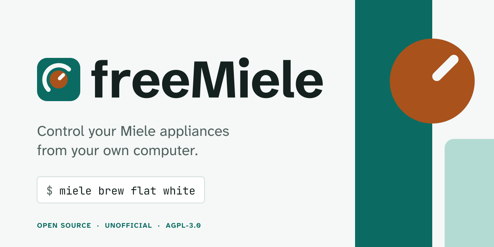

<picture>
  <source media="(prefers-color-scheme: dark)" srcset="assets/banner/freemiele-banner-dark.svg">
  
</picture>

# freeMiele

Control your Miele appliances from your Mac's terminal: see what they're doing, follow a wash
live, turn them on and off, and make a coffee.

```text
$ miele status
CM6160 Coffee machine: In use, Degreasing the brew unit (mobile start off)
WTR860 Washer dryer: In use, Sportswear · Rinsing, 0h23 left (mobile start off)
```

Unofficial. Not made or endorsed by Miele. Uses Miele's official cloud API with your own free key.

**Tested on** a CM 6160 coffee machine and a WTR860 washer-dryer, on macOS. Other Miele
appliances should show their status too, but nobody has tried them yet: see
[supported appliances](docs/appliances.md) and [help us test yours](#help-us-support-more-appliances).

## Before you start: get your Miele keys (5 minutes)

freeMiele talks to Miele's official cloud API, which needs a free personal key pair.

1. **Pair your appliance in the Miele app**, so it shows up on your Miele account.
2. **Register** at <https://developer.miele.com/get-involved>: choose the personal,
   non-commercial option, give any application name (e.g. "freeMiele") and your email.
3. **Keep the two values Miele gives you:** a **client ID** and a **client secret**.
   They are yours alone: never share them, paste them into issues or commit them.
   One email address gets one key pair; registering again replaces the old one.
4. **Log in:** run `miele login`, paste the client ID and secret, and sign in with your
   Miele account in the browser window that opens.
5. **Check it works:** `miele status` should list your appliances.

Stuck? Ask in [Discussions](https://github.com/cubetes/freeMiele/discussions).

## Install

Download the file for your computer from the [latest release](https://github.com/cubetes/freeMiele/releases/latest),
unpack it, and put `miele` somewhere on your `PATH`. Or, with [Rust](https://rustup.rs) installed:

```sh
cargo install --git https://github.com/cubetes/freeMiele
```

On a Mac, a downloaded `miele` is blocked the first time because it isn't signed by Apple. Allow it once
with `xattr -d com.apple.quarantine miele`.

Your login is kept in the macOS Keychain (entry `miele-cli`), never in a file, so only the macOS
builds remember it today ([#7](https://github.com/cubetes/freeMiele/issues/7): help wanted for
Linux and Windows). After installing a new version, macOS asks once whether `miele` may read it:
click **Always Allow**.

## Use

```sh
miele status           # what every appliance is doing right now
miele watch            # live updates until you press Ctrl+C
miele on               # turns on whichever appliance allows it
miele off
miele brew             # lists the drinks your machine offers
miele brew flat white
miele brew --device CM6160 espresso   # pick the appliance by name or model if you have several
miele care             # how often your coffee machine has been cleaned, and the care schedule
miele usage            # water and energy history (needs Data Act access from Miele, see below)
miele usage --runs     # the latest runs
miele dump             # raw appliance data for a support report, serial numbers removed
miele logout           # ends the login at Miele and deletes it from this computer
```

**Coffee:** put a cup under the spout before `brew`, because the machine starts straight away.
Miele only allows a remote drink when **Mobile Start** is on at the machine, and it switches off
after each drink. `status` shows "(mobile start off)" when it's needed. Options like DoubleShot or
two portions aren't available through Miele's API ([#34](https://github.com/cubetes/freeMiele/issues/34)).

**Laundry:** `status` and `watch` show the programme, phase and time left, and "Finished" at the
end. Starting, stopping and pausing from the computer are planned
([v0.5 Boron](https://github.com/cubetes/freeMiele/milestone/4)).

**Usage history** comes from Miele's EU Data Act API. Miele grants access on request, so until
then `miele usage` says so ([#10](https://github.com/cubetes/freeMiele/issues/10)).

## Help us support more appliances

What an appliance can do over the API differs by model. To add support for yours, log in and run:

```sh
miele dump > appliance.json
```

It reads (never changes) your appliances' status, actions and programmes. Serial numbers and
names are removed. Check the file, then attach it to an
[Appliance support report](https://github.com/cubetes/freeMiele/issues/new?template=appliance.yml).

## Contribute

- Questions and ideas: [Discussions](https://github.com/cubetes/freeMiele/discussions)
- Small tasks that need no Miele appliance: [good first issues](https://github.com/cubetes/freeMiele/labels/good%20first%20issue)
- What's planned: the [project board](https://github.com/users/cubetes/projects/2) and [milestones](https://github.com/cubetes/freeMiele/milestones)
- How we work: [CONTRIBUTING.md](CONTRIBUTING.md)

## Develop

```sh
cargo fmt --all --check
cargo clippy --workspace --all-targets -- -D warnings
cargo test --workspace
```

Two crates: `crates/core` talks to Miele, `crates/cli` is the `miele` command. Tests run against
the sample files in `fixtures/`, never the live API.

## Logo

In `assets/logo/` (mark, name lockup, app icon, light and dark) and `assets/banner/`. The name is
drawn as shapes, so no font is needed. Teal and copper only; never Miele's red or logo. Colours,
fonts and rules: [`design/`](design/).

## Licence

AGPL-3.0-or-later. See [LICENSE](LICENSE). You may use, change and share this code, but
anything you build on it and share (including as an online service) must also be AGPL.
